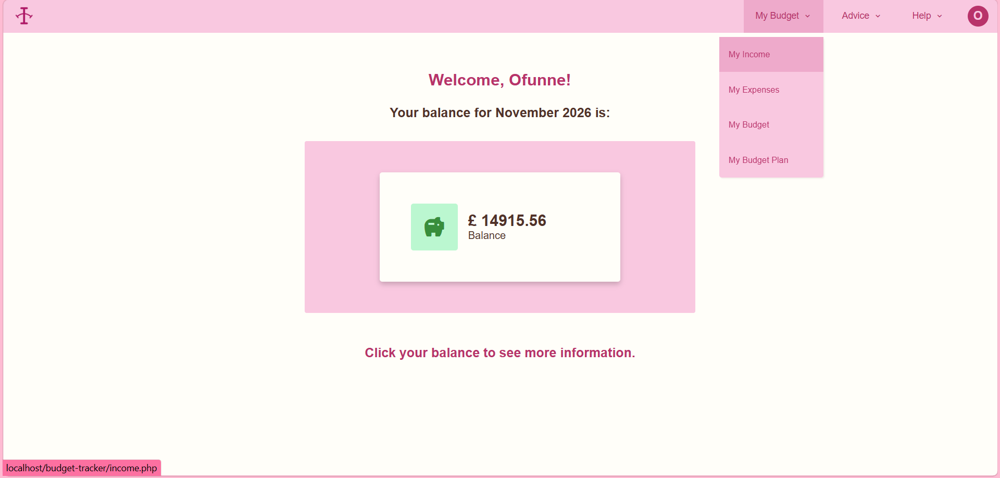
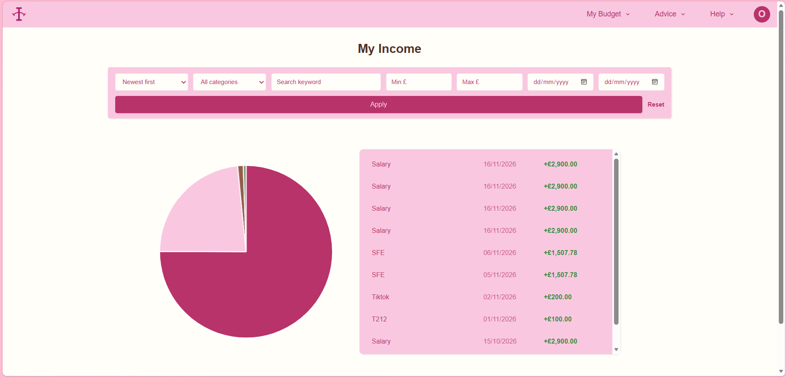
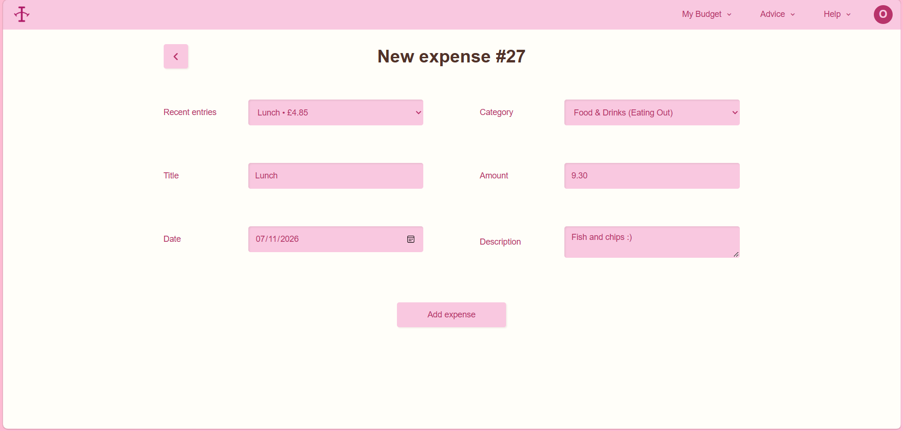
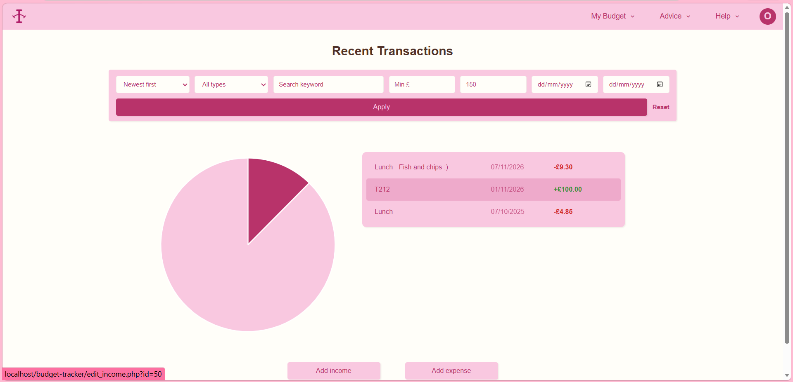
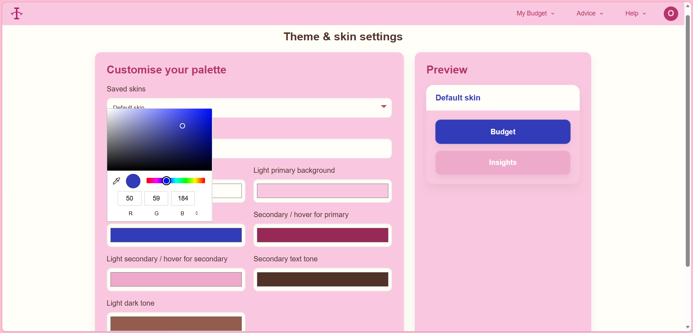

## My Budget Tracker

### Description

My Budget Tracker is a website designed to assist users in tracking their finances. With functionalities for tracking different streams of income and recording expenses it offers way for people to monitor their daily finances. This website is particularly useful for those who want to keep a close eye on their spending and maintain a balanced budget. 

### Built with

### Features

<b>Add Income:</b> Various streams of income, including salary, freelancing, and social media. 

<b>Add Purchase:</b> Record and categorise your expenses, helping you visualise where your money is going. 

<b>Table of income/expenses:</b> Display all recorded expenses and income, allowing you to review your financial history for better financial planning. 

<b>Check Balance:</b> View your current balance, calculated by deducting total expenses from total income. 

<b>Monthly tracking:</b> Filter your income/expenses by month and see this reflected in your total balance.

### Prerequisites
- XAMPP
- Basic knowledge of PHP, mySQL, HTML/CSS, and JavaScript.
- A code editor like VSCode

### Usage Guide
#### Homepage
When logged in, the homepage displays a card with your balance for the current month. Clicking on the card expands it to show a summary of income and spending.

#### Adding Income and Expenses
Clicking on the spending or income card takes you to another page where you can view your income streams or expenses.

#### Editing and Delting
You can add a new entry, and you can also edit or delete any input by clicking on the entry in the table.

#### Monthly Income
You can filter for date, amount, category, as well as searching for key words.

#### Customise the Website
You can customise your user experience by changing the theme of the website.

### Contact me

Feel free to [pop me an email](mailto:ofunnemordi1@outlook.com) or [visit my LinkedIn](https://www.linkedin.com/in/ofunnemordi)